 

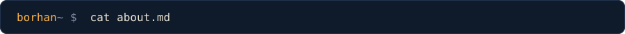

I build complete products, not just pages. A typical project covers the storefront a customer sees, the admin panel the team works in, the database and permissions underneath, and the marketing tracking that tells the business what is working.

- **E-commerce** with cash-on-delivery checkout, order tracking, invoices, size and variant inventory
- **Business tools** with finance ledgers, profit & loss, partner profit sharing and role-based access
- **Growth stack** wired in from day one: Meta Pixel and Conversions API, GA4, product feeds, technical SEO
- **The careful parts**: row-level security, 2-step admin login, audit logs, backups and CI checks

 

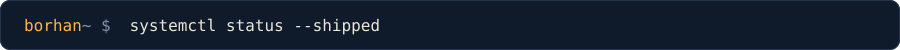

<a href="https://github.com/Borhan-Dipto/obsidian-platform">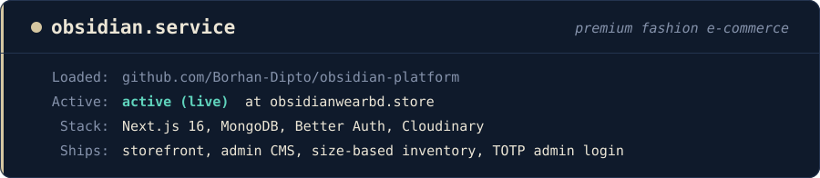</a>
<a href="https://github.com/Borhan-Dipto/VEST">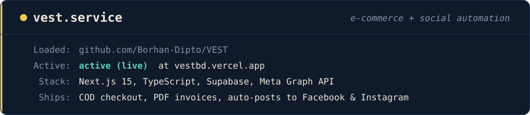</a>
<a href="https://github.com/Borhan-Dipto/CORE">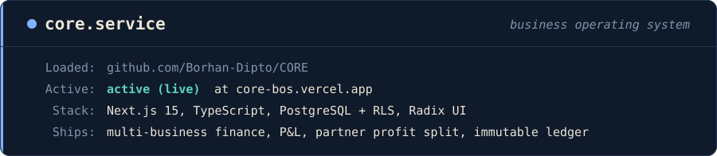</a>
<a href="https://github.com/Borhan-Dipto/eternity-gadget">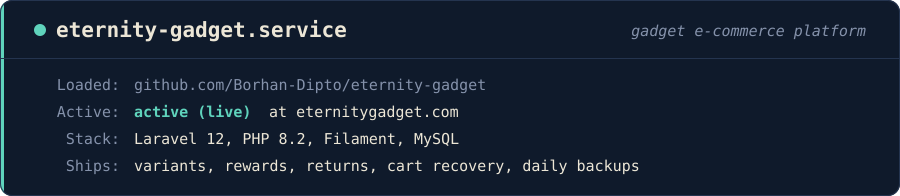</a>

Visit the live sites: [obsidianwearbd.store](https://obsidianwearbd.store) · [vestbd.vercel.app](https://vestbd.vercel.app) · [core-bos.vercel.app](https://core-bos.vercel.app) · [eternitygadget.com](https://eternitygadget.com)

 

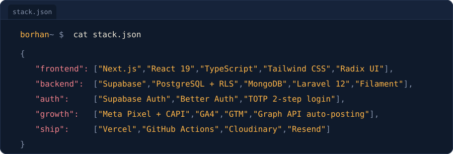

 

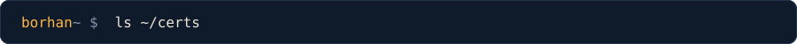

  
  

**AWS Academy Graduate**, Introduction to Cloud, Semesters 1 and 2. Issued by Amazon Web Services Training and Certification, verified on Credly.

 

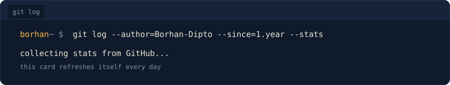

 

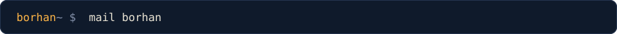

Have an online store, dashboard or custom web app in mind? Email me at **[borhandipto.bdu@gmail.com](mailto:borhandipto.bdu@gmail.com)**.

Every graphic on this page is hand-built SVG, generated by the scripts in [`/scripts`](./scripts). The activity card refreshes itself daily with GitHub Actions.
